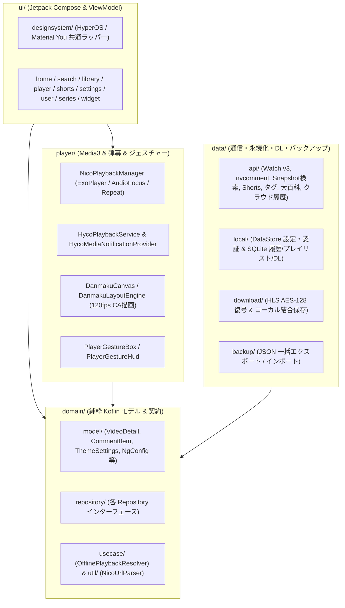

# HycoHyco (ハイコハイコ) プロジェクト全体概要 & アーキテクチャ設計

## 1. プロジェクト概要

- **アプリ名**: `HycoHyco`（ハイコハイコ）
- **コンセプト**: **「HyperOS」と「Material You」のデザインシステムを切り替えられる、完全ネイティブ Android 向けサードパーティ製ニコニコ動画クライアント**
- **対象プラットフォーム**: Android 8.0+ (API 26+) / `compileSdk = 36` / `targetSdk = 36`
- **パッケージ名**: `com.github.stm7128.hycohyco`

---

## 2. コアアーキテクチャ

Clean Architecture + Unidirectional Data Flow（UDF）を採用し、レイヤー間の依存方向を一方向に整理しています。



### 設計方針一覧

| 項目 | 設計方針 |
| :--- | :--- |
| **ネイティブ主義** | 一覧・プレイヤー・コメント・マイリスト等はすべて Jetpack Compose ネイティブ実装（公式アカウント認証時の 2FA / reCAPTCHA 通過のみ一時的 WebView を使用し、`user_session` 抽出後に即破棄） |
| **ハイブリッド利用** | ログインなしでも動画視聴・コメント閲覧・検索・ローカルプレイリスト・オフライン保存が利用可能。ログインするとフォロー新着・マイリスト・いいね・コメント投稿・ニコる・クラウド履歴を利用可能 |
| **デュアル・デザインシステム** | `ui/designsystem/` の `HycoTheme` と共通 UI コンポーネント（`HycoCard`, `HycoScaffold`, `HycoPullToRefreshBox` 等）により、HyperOS (`miuix`) と Material You (`Material 3`) を設定画面から即座に切替可能 |
| **弾幕描画エンジン** | 16:9（ショート時 9:16）仮想座標系と事前確保 `Paint`/`Typeface` によるゼロアロケーション Compose `Canvas` 描画、黒コメント自動白縁取り、CA（コメントアート）対応 |
| **ファイル分割規約** | 1 Kotlin ソースファイル **300 行以内** を維持し、責務ごとの小ファイル分割を徹底 |

---

## 3. ディレクトリ構成

各ファイルの詳細な解説は [**doc/FILE_GUIDE.md**](FILE_GUIDE.md) を参照してください。

```text
app/src/main/java/com/github/stm7128/hycohyco/
 ├── HycoHycoApp.kt             # Application エントリーポイント & Koin 初期化
 ├── di/                        # Koin DI モジュール (AppModule, ViewModelModule)
 ├── data/
 │    ├── api/                  # ニコニコ各種 Web API クライアント & 共通 OkHttp/Ktor エンジン
 │    ├── backup/               # JSON 一括エクスポート・復元マネージャー & DTO
 │    ├── download/             # HLS 解析・AES-128 復号・オフライン保存サービス
 │    ├── local/                # DataStore 設定永続化 & db/ (SQLite 履歴・プレイリスト・DL DAO)
 │    ├── model/                # API レスポンス DTO 群
 │    └── repository/           # Repository 実装・Watch キャッシュ・タグ/詳細マッパー
 ├── domain/
 │    ├── model/                # ドメインモデル・NG判定・コマンド/並び替え定義
 │    ├── repository/           # Repository インターフェース群
 │    ├── usecase/              # オフライン再生データ解決 UseCase
 │    └── util/                 # URL/共有インテント解析・日付フォーマット等
 ├── player/
 │    ├── NicoPlaybackManager.kt # Media3 (ExoPlayer) 統合再生マネージャー
 │    ├── SleepTimerManager.kt  # スリープタイマー制御
 │    ├── danmaku/              # 仮想座標定義・CA レーン計算・120fps Canvas 描画
 │    ├── gesture/              # 輝度/音量/ダブルタップシーク/長押し2倍速 HUD・ジェスチャー
 │    ├── model/                # PlaybackState シールドモデル
 │    └── service/              # MediaSessionService・通知/HyperOS スーパー島プロバイダー
 ├── ui/
 │    ├── MainActivity.kt       # Compose ホスト・PiP/Intent/エッジツーエッジ制御
 │    ├── MainViewModel.kt      # アプリ全体のテーマ設定管理
 │    ├── common/               # 共有 URL シート等の共通 UI
 │    ├── designsystem/         # HycoTheme・カラーシステム・デュアルテーマ UI コンポーネント群
 │    ├── home/                 # おすすめ / ランキング / フォロー新着 / ショートグリッド
 │    ├── library/              # 端末履歴 / クラウド各種履歴 / プレイリスト / DL 管理
 │    ├── main/                 # メインシェル (トップバー / ボトムナビ / オーバーレイ配線)
 │    ├── player/               # 展開/全画面/ミニプレイヤー・サイドパネル・弾幕/再生設定シート
 │    ├── search/               # 動画/タグ/ユーザー検索・履歴・直接ジャンプ
 │    ├── series/               # 単体シリーズ詳細シート
 │    ├── settings/             # アカウント認証・テーマ・グローバル再生/弾幕/NG・バックアップ設定
 │    ├── setup/                # 初回起動テーマ選択画面
 │    ├── shorts/               # VerticalPager 縦スワイプ連続視聴ショートプレイヤー
 │    ├── user/                 # ユーザー詳細シート（投稿動画/シリーズ/マイリスト/フォロー）
 │    └── widget/               # Jetpack Compose Glance ホーム画面再生ウィジェット
 └── util/
      └── NetworkHelper.kt      # Wi-Fi / 有線LAN 接続判定ヘルパー
```

---

## 4. 関連ドキュメント

- [**doc/FILE_GUIDE.md**](FILE_GUIDE.md) — 全ソースファイル・モジュールごとの役割と主要クラス一覧
- [**doc/NICO_API_REFERENCE.md**](NICO_API_REFERENCE.md) — ニコニコ動画 内部 API 仕様・ヘッダー・実装知見リファレンス
