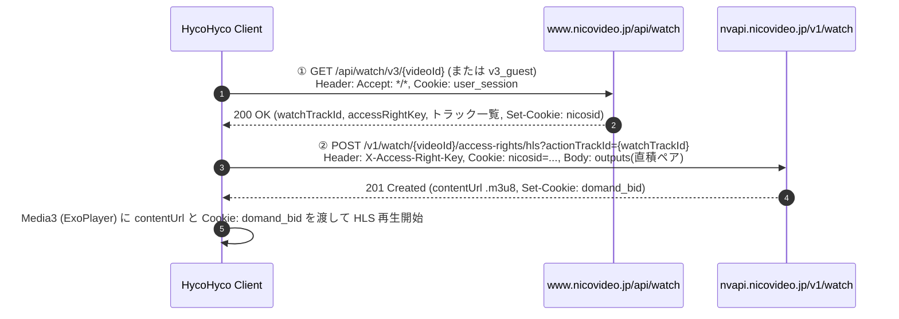

# ニコニコ動画 内部API 完全リファレンス & 知見チートシート (HycoHyco 開発ナレッジ)

このドキュメントは、サードパーティ製ニコニコ動画クライアント **「HycoHyco（ハイコハイコ）」** の開発過程で解析・検証・蓄積された、**ニコニコ動画（nicovideo.jp）の内部 API 仕様・エンドポイント・必須ヘッダー・通信フロー・注意点・ハマりどころ** を網羅的に集約した総合辞書です。

将来の機能拡張時や別セッションへの引き継ぎ時、Web 検索やリバースエンジニアリングをやり直すことなく、このドキュメント 1 枚で即座に正確な実装を行えるように永続化されています。

---

## 目次

1. [共通ルール・認証・必須ヘッダー](#1-共通ルール認証必須ヘッダー)
2. [Watch API & Domand HLS (動画再生基盤)](#2-watch-api--domand-hls-動画再生基盤)
3. [nvcomment API (コメント取得・投稿・自コメント削除)](#3-nvcomment-api-コメント取得投稿自コメント削除)
4. [スナップショット検索 API v2 & ランキング](#4-スナップショット検索-api-v2--ランキング)
5. [公式クラウドライブラリ API (あとで見る・マイリスト)](#5-公式クラウドライブラリ-api-あとで見るマイリスト)
6. [フォロー新着タイムライン API (2024年8月リニューアル版)](#6-フォロー新着タイムライン-api-2024年8月リニューアル版)
7. [双方向インタラクション API (「いいね！」送信/解除)](#7-双方向インタラクション-api-いいね送信解除)
8. [ユーザー・シリーズ・チャンネル API](#8-ユーザーシリーズチャンネル-api)
9. [知っておくべきエラーコード & トラブルシューティング](#9-知っておくべきエラーコード--トラブルシューティング)

---

## 1. 共通ルール・認証・必須ヘッダー

### 1.1 基本リクエストヘッダー
ニコニコ動画の API (`nvapi.nicovideo.jp`, `www.nicovideo.jp`, `api.feed.nicovideo.jp`) を叩く際は、以下のヘッダーが必須です。

| ヘッダー名 | 推奨値 / 仕様 | 備考 |
| :--- | :--- | :--- |
| `User-Agent` | `Mozilla/5.0 (Linux; Android 14; Pixel 8) AppleWebKit/537.36 ... HycoHyco/1.0` | 公式クライアントまたはモダンブラウザを模倣 |
| `X-Frontend-Id` | `6` | Web フロントエンド識別子 (Android 公式は `3` だが API 仕様が一部異なるため Web の `6` を推奨) |
| `X-Frontend-Version` | `0` | フロントエンドバージョン |
| `X-Request-With` | `https://www.nicovideo.jp` | CSRF 防止ヘッダー (一部エンドポイントで必須) |
| `Origin` | `https://www.nicovideo.jp` | POST / DELETE 送信時の CORS/CSRF チェック用 |
| `Referer` | `https://www.nicovideo.jp/watch/{videoId}` | 動画視聴・操作時の参照元 URL |

### 1.2 認証 Cookie の取り扱い
- ニコニコの認証は Cookie (`user_session` および `user_session_secure`) で管理されます。
- **WebView からの抽出**:
  - `https://account.nicovideo.jp/login` でユーザーがログインを完了した後、`android.webkit.CookieManager` から `user_session` (`user_session_XXXXX`) を抽出し、DataStore に永続化。WebView は即破棄します。
- **リクエスト時の送信形式**:
  - `Cookie: user_session=user_session_XXXXX`

---

## 2. Watch API & Domand HLS (動画再生基盤)

ニコニコ動画は 2024 年現在、従来の DMC 配信から **Domand (HLS)** 配信へ完全移行しています。動画を再生するには **2段階のリクエスト** が必要です。



### 2.1 Step ①: Watch メタデータ取得
- **URL**:
  - 未ログイン時: `GET https://www.nicovideo.jp/api/watch/v3_guest/{videoId}?actionTrackId={actionTrackId}`
  - ログイン時: `GET https://www.nicovideo.jp/api/watch/v3/{videoId}?actionTrackId={actionTrackId}`
- **必須ヘッダー**:
  - `Accept: */*` (⚠️ **重要**: `application/json` を送ると Apache コンテントネゴシエーションにより `406 Not Acceptable` エラーになります)
  - `X-Frontend-Id: 6`, `X-Frontend-Version: 0`
  - `Cookie: user_session=...` (ログイン時)
- **レスポンスから抽出する重要キー**:
  - `data.client.watchTrackId`: Step ② のクエリ `actionTrackId` に渡す追跡 ID
  - `data.media.domand.accessRightKey`: Step ② のヘッダー `X-Access-Right-Key` に渡すワンタイムトークン
  - `data.media.domand.videos[]`: 利用可能な映像トラック (`id`, `label`, `bitRate`, `height`)
  - `data.media.domand.audios[]`: 利用可能な音声トラック (`id`, `bitRate`)
  - `Set-Cookie`: レスポンスヘッダーから **`nicosid`** Cookie を抽出（Step ② で必須）
  - `data.comment.nvComment`: コメントサーバー情報（後述）
  - `data.video.viewer.like.isLiked`: いいね済み状態 (⚠️ **最重要**: `data.like` ではなく `data.video.viewer.like.isLiked` 配下に格納される)
  - `data.video.count.like`: 動画の総いいね数
  - `data.owner.viewer.isFollowing`: ⚠️ **注意: 常に `false` を返すダミー値**。実際のフォロー判定には後述の `user-follow-api.nicovideo.jp/v1/user/followees/bulk/niconico-users.json` を使用すること。
  - `data.series`: 所属シリーズ情報（前後の動画 ID）
- **エラー時（非公開・削除・会員限定等）のレスポンス仕様**:
  - ステータス: `400 Bad Request` (errorCode: `FORBIDDEN`) または `404 Not Found`
  - `data.reasonCode`:
    - `RIGHT_HOLDER_DELETE_VIDEO`: 権利者申し立てによる削除
    - `ADMINISTRATOR_DELETE_VIDEO`: 運営管理者による削除
    - `DELETED_VIDEO` / `DELETED_POSTER_VIDEO`: 投稿者による削除
    - `DELETED_CHANNEL_VIDEO` / `DELETED_COMMUNITY_VIDEO`: チャンネル閉鎖 / コミュニティ削除
    - `HIDDEN_VIDEO` / `PRIVATE_VIDEO`: 非公開設定
    - `CHANNEL_MEMBER_ONLY`: チャンネル会員限定
    - `COMMUNITY_ONLY`: コミュニティ限定
    - `PREMIUM_ONLY`: プレミアム会員限定
    - `PPV_VIDEO`: 有料（PPV）動画
    - `HARMFUL_VIDEO`: センシティブ・年齢制限
    - `DOMESTIC_VIDEO` / `HIGH_RISK_COUNTRY_VIDEO`: 地域制限
  - `data.deletedMessage`: 公式の具体的な削除理由文面（HTMLタグ `<br>` を含む。例: `この動画は個人の申立により、肖像権侵害として削除されました。<br>対象物: 個人の肖像`）

### 2.2 Step ②: Domand HLS アクセス権取得
- **URL**: `POST https://nvapi.nicovideo.jp/v1/watch/{videoId}/access-rights/hls?actionTrackId={watchTrackId}`
- **必須ヘッダー**:
  - `X-Access-Right-Key`: `{accessRightKey}`
  - `X-Frontend-Id: 6`, `X-Frontend-Version: 0`
  - `X-Request-With: https://www.nicovideo.jp`
  - `Cookie: nicosid={nicosid}; user_session={user_session}` (⚠️ `nicosid` がないと `400 INVALID_PARAMETER` エラー)
  - `Content-Type: application/json`
- **リクエストボディ (`outputs`)**:
  - 利用可能な映像トラックと音声トラックの全組み合わせ直積ペア配列を送信します。
  ```json
  {
    "outputs": [
      ["video-h264-720p", "audio-aac-192kbps"],
      ["video-h264-720p", "audio-aac-64kbps"],
      ["video-h264-360p", "audio-aac-192kbps"],
      ["video-h264-360p", "audio-aac-64kbps"]
    ]
  }
  ```
- **レスポンス (201 Created)**:
  - `data.contentUrl`: HLS マスタープレイリスト (`.m3u8`) の URL
  - `Set-Cookie`: **`domand_bid=...`** (メディアセグメントのダウンロードに必須の認可 Cookie)

### 2.3 ExoPlayer (Media3) での再生
- `contentUrl` を `HlsMediaSource` に渡す際、OkHttp `DataSource.Factory` に `Cookie: domand_bid=...` を付加します。

---

## 3. nvcomment API (コメント取得・投稿・自コメント削除)

2024 年現在のニコニコ動画は、旧式メッセージサーバー（XML/パケット方式）を廃止し、**nvcomment (JSON API)** に統一されています。

### 3.1 コメント取得 & 自コメント自動判定
- **URL**: `POST https://nvcomment.nicovideo.jp/v1/threads` (または Watch API の `nvComment.server` で指定されたホスト)
- **ヘッダー**:
  - `X-Frontend-Id: 6`, `X-Frontend-Version: 0`
  - `Cookie: user_session=...` (⚠️ **推奨**: ログイン Cookie を付与してリクエストすると、サーバー側で自コメント判定が行われ、レスポンス各コメントに `isMyPost: true` が返却されます)
  - `Content-Type: application/json`
- **リクエストボディ**:
  ```json
  {
    "params": {
      "targets": [
        { "id": "スレッドID", "fork": "main" },
        { "id": "スレッドID", "fork": "easy" }
      ],
      "language": "ja-jp"
    },
    "threadKey": "{nvComment.threadKey}"
  }
  ```
- **コメントモデル**:
  - `id`: コメント固有 ID (String, 例: `"1569745841089982464"`)
  - `no`: コメント番号 (Long, 例: `35`)
  - `vposMs`: 再生開始からのミリ秒
  - `body`: コメント本文
  - `commands`: `["shita", "big", "red", "184"]` 等の修飾配列
  - `nicoruCount`: ニコられた数
  - `userId`: コメント投稿者ハッシュ ID
  - `isMyPost`: **自コメント判定フラグ** (`Boolean`)。ログイン時に自分が投稿したコメント（別ブラウザ再ログインや184匿名投稿含む）は自動的に `true` となる。公式クライアントはこのフラグをもとに弾幕に黄色枠（`#FFEE00`）を描画する。

### 3.3 コメントの「ニコる（Nicoru）」機能 (2段階フロー: nicoruKey 取得 → nicorus 投稿 & 解除)
ニコニコ動画のコメントに対して「ニコる（評価・賞賛）」を送信・解除する完全ネイティブ API 仕様。

#### ① ニコるキー取得 API (`nvapi`)
- **メソッド**: `GET`
- **URL**: `https://nvapi.nicovideo.jp/v1/comment/keys/nicoru?threadId={threadId}&fork={fork}` (デフォルト `fork=main`)
- **必須ヘッダー**:
  - `User-Agent`: 公式互換 UA
  - `X-Frontend-Id`: `6`
  - `X-Frontend-Version`: `0`
  - `Cookie`: `user_session=...` (ログイン必須)
- **レスポンス**:
  ```json
  {
    "meta": { "status": 200 },
    "data": {
      "nicoruKey": "eyJ0eXAiOiJKV1QiLCJhbGciOiJIUzUxMiJ9..."
    }
  }
  ```

#### ② ニコる実行 API (`nvcomment`)
- **メソッド**: `POST`
- **URL**: `https://{nvCommentServer}/v1/threads/{threadId}/nicorus?pc=1` (末尾の `?pc=1` が必須)
- **必須ヘッダー**:
  - `User-Agent`: 公式互換 UA
  - `X-Frontend-Id`: `6`
  - `X-Frontend-Version`: `0`
  - `X-Client-Os-Type`: `others` (または `android`)
  - `Content-Type`: `application/json`
  - ※ Cookie は不要（`nicoruKey` の JWT 内にユーザー識別子が含まれるため）
- **リクエストボディ (フラット JSON)**:
  ```json
  {
    "videoId": "{videoId}",
    "fork": "main",
    "no": 4118020,
    "content": "混ぜるな危険ｗｗｗ",
    "nicoruKey": "{nicoruKey}"
  }
  ```
- **レスポンス (HTTP 201 Created)**:
  ```json
  {
    "meta": { "status": 201 },
    "data": {
      "nicoruId": "01M7387GT3HJWVVSMEDHMGPK49",
      "nicoruCount": 158
    }
  }
  ```

#### ③ ニコる解除 API (`nvapi`)
- **メソッド**: `DELETE`
- **URL**: `https://nvapi.nicovideo.jp/v1/users/me/nicoru/send/{nicoruId}`
- **必須ヘッダー**:
  - `X-Frontend-Id`: `6`
  - `X-Frontend-Version`: `0`
  - `X-Request-With`: `https://www.nicovideo.jp`
  - `Cookie`: `user_session=...`
- **レスポンス (HTTP 200 OK)**:
  ```json
  {
    "meta": { "status": 200 },
    "data": []
  }
  ```

#### ④ ニコる数による背景色の階層（ヒートマップ表示）
公式アプリ・Web準拠のニコるレベル：
- **Lv0 (0件)**: 通常のダーク背景（透明）
- **Lv1 (1〜4件)**: ごく薄い琥珀色背景 (`#FFB300`, alpha: `0.08f`)
- **Lv2 (5〜9件)**: 中程度の琥珀色背景 (`#FFB300`, alpha: `0.16f`)
- **Lv3 (10〜29件)**: 濃い琥珀色背景 (`#FFB300`, alpha: `0.28f`)
- **Lv4 (30件以上)**: 最も濃い金色琥珀色背景 (`#FFB300`, alpha: `0.42f`)
- 自分がニコったコメントはアイコンが黄色点灯（`#FCD842`）し、数字も黄色表示。

### 3.2 コメント投稿 (2段階フロー: postKey 取得 → 投稿)
ログインユーザーがコメントを投稿する際は、事前に `postKey`（ワンタイム投稿トークン）を取得する必要があります。

1. **Step ①: `postKey` の取得**:
   - **URL**: `GET https://nvapi.nicovideo.jp/v1/comment/keys/post?threadId={threadId}`
   - ※`{threadId}` は Watch API の `data.comment.threads[]` のうち `isDefaultPostTarget == true` (または `forkLabel == "main"`) のスレッド `id`。
   - **必須ヘッダー**:
     - `X-Frontend-Id: 6`, `X-Frontend-Version: 0`
     - `Cookie: user_session=...`
   - **レスポンス (200 OK)**:
     ```json
     {
       "meta": { "status": 200 },
       "data": {
         "postKey": "eyJ0eXAiOiJKV1QiLCJhbGciOiJIUzUxMiJ9...",
         "challenge": { "isRequired": false }
       }
     }
     ```
2. **Step ②: コメント本体の POST**:
   - **URL**: `POST https://public.nvcomment.nicovideo.jp/v1/threads/{threadId}/comments` (ホストは Watch API の `data.comment.nvComment.server`)
   - **必須ヘッダー**:
     - `X-Frontend-Id: 6`, `X-Frontend-Version: 0`
     - `X-Request-With: https://www.nicovideo.jp`
     - `Origin: https://www.nicovideo.jp`
     - `Cookie: user_session=...` (⚠️ **必須**: Cookie がないと `400 INVALID_TOKEN` となり投稿に失敗します)
     - `Content-Type: application/json`
   - **リクエストボディ**:
     ```json
     {
       "videoId": "sm46570898",
       "body": "コメント本文",
       "commands": ["184", "shita", "red"],
       "vposMs": 45200,
       "postKey": "{postKey}"
     }
     ```
   - **レスポンス (201 Created)**:
     ```json
     {
       "meta": { "status": 201 },
       "data": {
         "id": "1569754615552978944",
         "no": 293,
         "shouldRefreshKey": false
       }
     }
     ```
     ※⚠️ **注意**: レスポンスの `data` には `id` と `no` のみが返却され、`body` や `vposMs` は含まれません。クライアント側で投稿時の本文・再生位置を引き回す必要があります。

### 3.3 自コメント削除 (2段階フロー: deleteKey 取得 → PUT 送信)
自分が投稿したコメントを削除する際、公式 Web クライアントは以下の 2段階フローで処理します。

1. **Step ①: `deleteKey` の取得**:
   - **URL**: `GET https://nvapi.nicovideo.jp/v1/comment/keys/delete?threadId={threadId}`
   - **必須ヘッダー**:
     - `X-Frontend-Id: 6`, `X-Frontend-Version: 0`
     - `Cookie: user_session=...`
   - **レスポンス (200 OK)**:
     ```json
     {
       "meta": { "status": 200 },
       "data": {
         "deleteKey": "eyJ0eXAiOiJKV1QiLCJhbGciOiJIUzUxMiJ9..."
       }
     }
     ```
2. **Step ②: `comment-comment-owner-deletions` への PUT 送信**:
   - **URL**: `PUT https://public.nvcomment.nicovideo.jp/v1/threads/{threadId}/comment-comment-owner-deletions`
   - **必須ヘッダー**:
     - `X-Frontend-Id: 6`, `X-Frontend-Version: 0`
     - `Referer: https://www.nicovideo.jp/watch/{videoId}`
     - `Content-Type: application/json`
   - **リクエストボディ (JSON)**:
     ```json
     {
       "videoId": "sm45478959",
       "targets": [
         {
           "no": 35,
           "operation": "DELETE"
         }
       ],
       "fork": "main",
       "language": "ja-jp",
       "deleteKey": "{deleteKey}"
     }
     ```
   - ⚠️ **最重要知見（ハマりどころ）**:
     - **外殻 `params` ラップの禁止**: `{ "params": { ... } }` で送信すると `400 INVALID_PARAMETER` になります。必ずフラットな JSON を送信すること。
     - **`targets` の構造**: 要素は `{ "id": "...", "no": ... }` ではなく、**`{ "no": commentNo, "operation": "DELETE" }`** でなければなりません。`id` を含めたり `operation: "DELETE"` が欠落すると `400 INVALID_PARAMETER` になります。

---

## 4. スナップショット検索 API v2 & ランキング

### 4.1 スナップショット検索 API v2
- **URL**: `GET https://snapshot.search.nicovideo.jp/api/v2/snapshot/video/contents/search`
- **主要クエリパラメータ**:
  - `q`: 検索キーワード
  - `targets`: 検索対象フィールド（`title,description,tags`）
    - ⚠️ **重要ハマりどころ**: `targets` に `contentId` を含めると **`400 Bad Request`** になります。動画IDは `q` に含めて検索します。
  - `fields`: 取得するフィールド一覧（カンマ区切り）
    - `contentId,title,userId,viewCounter,commentCounter,likeCounter,mylistCounter,thumbnailUrl,startTime,lengthSeconds,genre`
    - ⚠️ `userId` を含めることで、検索結果に投稿者 ID を含めることができます。
  - `_sort`: 並び替え順
    - `-viewCounter` (再生数多い順), `+viewCounter` (少ない順)
    - `-mylistCounter` (マイリスト多い順)
    - `-likeCounter` (いいね多い順)
    - `-startTime` (投稿新しい順), `+startTime` (古い順)
    - `-lengthSeconds` (動画長い順), `+lengthSeconds` (短い順)
    - `-commentCounter` (コメント多い順)
  - `_limit`: 取得件数 (最大 100)
  - `_offset`: ページネーションオフセット

### 4.2 人気ランキング API
- **URL**: `GET https://nvapi.nicovideo.jp/v1/ranking/genre/{genre}?term=24h`
- **ジャンル一覧**:
  - `all` (全ジャンル), `hot-topic` (話題), `entertainment` (エンタメ), `radio` (ラジオ), `music_sound` (音楽), `dance` (ダンス), `animal` (動物), `nature` (自然), `cooking` (料理), `travel` (旅行), `vehicle` (乗り物), `sports` (スポーツ), `society_politics_news` (社会・政治), `technology_craft` (技術・工作), `commentary_lecture` (解説・講座), `anime` (アニメ), `game` (ゲーム), `other` (その他)

---

## 5. 公式クラウドライブラリ API (あとで見る・マイリスト)

### 5.1 「あとで見る」一覧
- **URL**: `GET https://nvapi.nicovideo.jp/v1/users/me/watch-later?page={page}&pageSize=25`
- **ヘッダー**: `X-Frontend-Id: 6`, `Cookie: user_session=...`

### 5.2 マイリスト一覧
- **URL**: `GET https://nvapi.nicovideo.jp/v1/users/me/mylists`
- **ヘッダー**: `X-Frontend-Id: 6`, `Cookie: user_session=...`

### 5.3 マイリスト詳細・動画一覧
- **URL**:
  - 自身のアカウントのマイリスト（非公開含む）: `GET https://nvapi.nicovideo.jp/v1/users/me/mylists/{mylistId}?page={page}&pageSize=25`
  - 他人の公開マイリスト: `GET https://nvapi.nicovideo.jp/v2/mylists/{mylistId}?page={page}&pageSize=25`
  - ※注意: 自身の非公開マイリスト（`isPublic: false`）に対して `v2/mylists/{id}` を呼び出すと、ログインセッションがあっても `403 FORBIDDEN` となるため、`v1/users/me/mylists/{id}` を使用すること。
- **ヘッダー**: `X-Frontend-Id: 6`, `Cookie: user_session=...`

### 5.4 「あとで見る」追加 (POST)
- **URL**: `POST https://nvapi.nicovideo.jp/v1/users/me/watch-later`
- **Content-Type**: `application/x-www-form-urlencoded`
- **Body**: `watchId={videoId}&memo=`
- **必須ヘッダー（重要）**:
  - `X-Frontend-Id: 6`, `X-Frontend-Version: 0`
  - `X-Request-With: https://www.nicovideo.jp` (※必須。未付与時は `400 INVALID_PARAMETER` となる)
  - `Origin: https://www.nicovideo.jp` (※必須。未付与時は `400 INVALID_PARAMETER` となる)
  - `Referer: https://www.nicovideo.jp/watch/{videoId}`
  - `Cookie: user_session=...`
- **成功時レスポンス**: `201 Created` (`{"meta":{"status":201},"data":{"watchLater":{"item":{...}}}}`)

### 5.5 マイリスト項目追加 (POST)
- **URL**: `POST https://nvapi.nicovideo.jp/v1/users/me/mylists/{mylistId}/items?itemId={videoId}&description=`
- **必須ヘッダー（重要）**:
  - `X-Frontend-Id: 6`, `X-Frontend-Version: 0`
  - `X-Request-With: https://www.nicovideo.jp` (※必須。未付与時は `400 INVALID_PARAMETER` となる)
  - `Origin: https://www.nicovideo.jp` (※必須。未付与時は `400 INVALID_PARAMETER` となる)
  - `Referer: https://www.nicovideo.jp/watch/{videoId}`
  - `Cookie: user_session=...`
- **成功時レスポンス**: `200 OK` (`{"meta":{"status":200}}`)

### 5.6 「あとで見る」項目削除 (DELETE)
- **URL**: `DELETE https://nvapi.nicovideo.jp/v1/users/me/watch-later?itemIds={itemId}`
- **クエリパラメータ**: `itemIds`（**数値の `WatchLaterItemDto.itemId` が必須**。動画ID `smXXXX` を渡すと削除できないため、`VideoSummary.cloudItemId` を保持して渡すこと。`NicoCloudApiClient` では非数値指定時に一覧再取得で `cloudItemId` へ自動解決するフォールバックも実装）
- **必須ヘッダー**:
  - `Accept: application/json;charset=utf-8`
  - `X-Frontend-Id: 6`, `X-Frontend-Version: 0`
  - `X-Request-With: https://www.nicovideo.jp`
  - `Origin: https://www.nicovideo.jp`
  - `Referer: https://www.nicovideo.jp/my/watchlater`
  - `Cookie: user_session=...`
- **成功時レスポンス**: `200 OK` (`{"meta":{"status":200}}`)

### 5.7 マイリスト項目削除 (DELETE)
- **URL**: `DELETE https://nvapi.nicovideo.jp/v1/users/me/mylists/{mylistId}/items?itemIds={itemId}`
- **クエリパラメータ**: `itemIds`（**数値の `WatchLaterItemDto.itemId` (`cloudItemId`) が必須**。動画ID `smXXXX` 不可。非数値指定時は一覧再取得による自動解決フォールバックを実施）
- **必須ヘッダー**:
  - `Accept: application/json;charset=utf-8`
  - `X-Frontend-Id: 6`, `X-Frontend-Version: 0`
  - `X-Request-With: https://www.nicovideo.jp`
  - `Origin: https://www.nicovideo.jp`
  - `Referer: https://www.nicovideo.jp/my/mylist/{mylistId}`
  - `Cookie: user_session=...`
- **成功時レスポンス**: `200 OK` (`{"meta":{"status":200}}`)

---

## 6. フォロー新着タイムライン API (2024年8月リニューアル版)

⚠️ **最重要知見**:
2024 年 8 月のシステム障害・リニューアル以降、旧エンドポイント（`follow/videos` 等）は **すべて 404 Not Found** となっています。

### 6.1 正規エンドポイント
- **URL**: `GET https://api.feed.nicovideo.jp/v1/activities/followings/video?context=my_timeline`
- **必須ヘッダー**:
  - `X-Frontend-Id: 6`, `X-Frontend-Version: 0`
  - `Cookie: user_session=...`
- **レスポンス構造 (`activities` 配列形式)**:
  ```json
  {
    "activities": [
      {
        "id": "...",
        "activityType": "upload",
        "createdAt": "2024-09-01T12:00:00+09:00",
        "actor": {
          "id": "123456",
          "name": "投稿者ニックネーム",
          "iconUrl": "https://..."
        },
        "content": {
          "id": "sm43000000",
          "title": "動画タイトル",
          "startedAt": "2024-09-01T12:00:00+09:00",
          "video": { "duration": 180 }
        },
        "thumbnailUrl": "https://..."
      }
    ]
  }
  ```
- ⚠️ **データ欠落の補完 (Enrichment) 必須仕様**:
  - アクティビティ形式であるため、レスポンスに `count`（再生数・コメント数・いいね数・マイリス数）が含まれていません。
  - クライアント側で `getVideoDetail(videoId)` を非同期に呼び出し、画面表示時に 4 大指標を自動補完（Enrichment）する必要があります。

---

## 7. 双方向インタラクション API (「いいね！」送信/解除)

⚠️ **最重要知見**:
パスパラメータ形式（`/v1/users/me/likes/videos/{videoId}`）は **存在せず 404 Not Found** となります。正規エンドポイントはクエリパラメータ形式です。

### 7.1 「いいね！」送信 (POST)
- **URL**: `POST https://nvapi.nicovideo.jp/v1/users/me/likes/items?videoId={videoId}`
- **必須ヘッダー**:
  - `X-Frontend-Id: 6`, `X-Frontend-Version: 0`
  - `X-Request-With: https://www.nicovideo.jp`
  - `Origin: https://www.nicovideo.jp`
  - `Referer: https://www.nicovideo.jp/watch/{videoId}`
  - `Cookie: user_session=...`
- **レスポンス (200 OK)**:
  ```json
  {
    "meta": { "status": 200 },
    "data": {
      "thanksMessage": "いいねありがとうございます！次回作は来週金曜予定です！"
    }
  }
  ```
  ※`thanksMessage` は投稿者が設定している場合のみ文字列、未設定時は `null` または空文字。

### 7.2 「いいね！」解除 (DELETE)
- **URL**: `DELETE https://nvapi.nicovideo.jp/v1/users/me/likes/items?videoId={videoId}`
- **必須ヘッダー**: 送信時と同一
- **レスポンス**: `200 OK` (`{"meta": {"status": 200}}`)

---

## 8. ユーザー・シリーズ・チャンネル API

### 8.1 投稿者プロフィール
- **URL**: `GET https://nvapi.nicovideo.jp/v1/users/{userId}`
- **取得可能データ**: `nickname`, `icons.large`, `description` (自己紹介文 HTML), `followerCount`

### 8.2 投稿者の投稿動画一覧
- **URL**: `GET https://nvapi.nicovideo.jp/v3/users/{userId}/videos?pageSize={pageSize}&page={page}`
- **レスポンス**: `data.items[].essential` に動画情報および統計情報 (`count`) が完全に入った状態で返却される。

### 8.3 ユーザーシリーズ一覧
- **URL**: `GET https://nvapi.nicovideo.jp/v1/users/{userId}/series`
- **取得可能データ**: `id`, `title`, `description`, `thumbnailUrl`, `itemsCount`

### 8.4 フォロー中ユーザー一覧
- **URL**: `GET https://nvapi.nicovideo.jp/v1/users/me/following/users` (または `/v1/users/{userId}/following/users`)
- **ヘッダー**: `Cookie: user_session=...`
- **注意点**: 各アイテムのアイコン画像は `iconUrl` ではなく `icons: { "small": "...", "large": "..." }` オブジェクトに格納されています。

### 8.5 ユーザーフォロー追加 / 解除 API
⚠️ **最重要知見**:
ユーザーのフォロー追加・解除は `nvapi.nicovideo.jp` ではなく **`user-follow-api.nicovideo.jp`** ドメインで処理されます（`nvapi` に POST すると 405 Method Not Allowed または 404 Not Found となります）。

- **フォロー追加 (POST)**:
  - **URL**: `POST https://user-follow-api.nicovideo.jp/v1/user/followees/niconico-users/{userId}.json`
  - **必須ヘッダー**:
    - `X-Frontend-Id: 6`, `X-Frontend-Version: 0`
    - `X-Request-With: https://www.nicovideo.jp`
    - `Origin: https://www.nicovideo.jp`
    - `Referer: https://www.nicovideo.jp/`
    - `Cookie: user_session=...`
  - **レスポンス (200 OK)**:
    ```json
    { "meta": { "status": 200 } }
    ```
- **フォロー解除 (DELETE)**:
  - **URL**: `DELETE https://user-follow-api.nicovideo.jp/v1/user/followees/niconico-users/{userId}.json`
  - **必須ヘッダー**: 送信時と同一
  - **レスポンス (200 OK)**:
    ```json
    { "meta": { "status": 200 } }
    ```

### 8.6 ユーザーフォロー状態 判定 API (一括判定)
⚠️ **最重要知見**:
Watch API の `data.owner.viewer.isFollowing` は **常に `false` を返す未実装ダミー値** です。
公式 Web クライアントでも本エンドポイントを叩いて正確なフォロー状況を取得しています。

- **URL**: `GET https://user-follow-api.nicovideo.jp/v1/user/followees/bulk/niconico-users.json?targetIds={userId1},{userId2}`
- ⚠️ **重要ハマりどころ**:
  - クエリパラメータ名は `userIds` ではなく **`targetIds`** である必要があります（`userIds` では対象がヒットせず常に未フォロー判定になります）。
- **必須ヘッダー**:
  - `User-Agent`: 公式互換 UA
  - `X-Frontend-Id: 6`, `X-Frontend-Version: 0`
  - `X-Request-With: https://www.nicovideo.jp`
  - `Origin: https://www.nicovideo.jp`
  - `Referer: https://www.nicovideo.jp/`
  - `Cookie: user_session=...`
- **レスポンス (200 OK)**:
  ```json
  {
    "meta": { "status": 200 },
    "data": {
      "followees": {
        "124354271": {
          "following": true
        }
      }
    }
  }
  ```
- `data.followees["{userId}"].following == true` で判定します。未フォローの場合は `{"following": false}` が返却されます。

### 8.7 フォロワー一覧 API
- **URL**: `GET https://nvapi.nicovideo.jp/v1/users/{userId}/followed-by/users?pageSize={pageSize}&page={page}` (または `/v1/users/me/followed-by/users`)
- **必須ヘッダー**:
  - `X-Frontend-Id: 6`, `X-Frontend-Version: 0`
  - `Cookie: user_session=...`
- **レスポンス構造**: フォロー中一覧（`8.4`）と完全に同一の `data.items[]`（`id`, `nickname`, `icons`, `relationships.sessionUser.isFollowing`）が返却されます。

### 8.8 関連動画 & ホームおすすめ (レコメンド) 取得 API
- **関連動画 URL**: `GET https://nvapi.nicovideo.jp/v1/recommend?recipeId=video_watch_recommendation&videoId={videoId}&site=nicovideo`
- **ホームおすすめ動画 URL**: `GET https://nvapi.nicovideo.jp/v1/recommend?recipeId=video_recommendation_recommend&recipeVersion=1&site=nicovideo&limit=50`
  - ※ `video_recommendation_recommend` は最大 50 件取得でき、ゲスト時は人気推薦、ログイン Cookie (`user_session`) 付与時は視聴履歴ベースのパーソナライズ推薦と `reason.tag`（おすすめ理由タグ）が返却されます（`X-Frontend-Id: 6`, `X-Frontend-Version: 0` 必須）。
- **必須ヘッダー**:
  - `X-Frontend-Id: 6`, `X-Frontend-Version: 0`, `X-Request-With: https://www.nicovideo.jp`
- **レスポンス構造**:
  - `data.items[]` のうち `contentType == "video"` の要素の `content` に、4大指標（`count.view`, `comment`, `mylist`, `like`）や投稿者情報（`owner.id`, `owner.name`, `owner.iconUrl`）、サムネイル、再生時間がすべて入った完全な動画オブジェクト（`CloudVideoItemDto` 互換）と `reason.tag` が返却されます。

### 8.9 動画基本情報 (Essential) 即時取得 API
- **URL**: `GET https://nvapi.nicovideo.jp/v1/videos?watchIds={watchId}`
- **必須ヘッダー**:
  - `X-Frontend-Id: 6`, `X-Frontend-Version: 0`, `X-Request-With: https://www.nicovideo.jp`
- **特徴・用途**:
  - スナップショット検索 API (`snapshot.search.nicovideo.jp`) はインデックス更新に数時間のタイムラグがあるため、投稿直後の超新着動画は 0 件で返却されます。
  - 一方、本エンドポイントは**投稿直後の最新動画でも即座（約 170ms）に正確な再生数・コメント・いいね・マイリスト数・投稿者名・アイコン URL** を返却します。
  - スナップショット検索 API で欠落した ID に対するフォールバック補完として活用されます。
- **レスポンス構造**:
  ```json
  {
    "meta": { "status": 200 },
    "data": {
      "items": [
        {
          "watchId": "sm47037798",
          "video": {
            "id": "sm47037798",
            "title": "...",
            "registeredAt": "2026-11-12T21:33:08+09:00",
            "count": { "view": 1, "comment": 0, "mylist": 0, "like": 0 },
            "thumbnail": { "nHdUrl": "...", "listingUrl": "...", "url": "..." },
            "duration": 41,
            "owner": { "id": "145874556", "name": "...", "iconUrl": "..." }
          }
        }
      ]
    }
  }
  ```

### 8.9 ユーザーキーワード検索 API (生放送・コミュニティ共通API)
- **URL**: `GET https://api.cas.nicovideo.jp/v1/search/users?searchWord={keyword}&limit={limit}`
- **必須ヘッダー**:
  - `X-Frontend-Id: 6`, `X-Frontend-Version: 0`
- **レスポンス構造**:
  ```json
  {
    "meta": { "status": 200, "totalCount": 4267 },
    "data": {
      "users": [
        {
          "id": "3343223",
          "nickname": "40mP",
          "icons": {
            "urls": {
              "150x150": "https://img.nicoprofile.nimg.jp/usericon/334/3343223.jpg?...",
              "50x50": "https://..."
            }
          },
          "description": "プロフィール文",
          "followerCount": 153418,
          "videoCount": 164,
          "liveCount": 191
        }
      ]
    }
  }
  ```
- ⚠️ ユーザーID直接指定（`user/12345` や数字）の場合は `https://nvapi.nicovideo.jp/v1/users/{userId}` を直接参照し、ニックネーム等のキーワード指定の場合は本 API で一括検索します。

---

## 9. 知っておくべきエラーコード & トラブルシューティング

| HTTP コード / エラー | 発生箇所 | 原因 | 解決策 |
| :--- | :--- | :--- | :--- |
| **`406 Not Acceptable`** | Watch API (`v3` / `v3_guest`) | `Accept: application/json` を送信した | `Accept: */*` を送信する |
| **`404 Not Found`** | いいね API | `likes/videos/{id}` を叩いた | `likes/items?videoId={id}` に変更する |
| **`404 Not Found`** | フォロー新着 API | 旧 `follow/videos` を叩いた | 新 `activities/followings/video` を叩く |
| **`405 / 404`** | ユーザーフォロー API | `nvapi.nicovideo.jp` に POST した | `user-follow-api.nicovideo.jp/v1/user/followees/niconico-users/{id}.json` を叩く |
| **`isFollowing: false` 固定** | Watch API (`owner.viewer`) | Watch API の `isFollowing` は未実装ダミー値 | `user-follow-api.nicovideo.jp/v1/user/followees/bulk/niconico-users.json` で判定する |
| **`400 Bad Request`** | スナップショット検索 | `targets` に `contentId` を含めた | `targets` から除外し `q` で検索する |
| **`400 INVALID_PARAMETER`** | Domand HLS 発行 | `Cookie` に `nicosid` がない | Watch API レスポンスヘッダから `nicosid` を引き回す |
| **`400 INVALID_PARAMETER`** | コメント削除 API | `params` でラップした、または `targets` に `id` を渡した | `{ no, operation: "DELETE" }` のフラット JSON を送信する |
| **`400 INVALID_TOKEN`** | コメント投稿 API | リクエストヘッダーに `Cookie: user_session` が欠落していた | ログイン Cookie をヘッダーに付与する |
| **`isFollowing: false` 固定** | フォロー状態 bulk API | パラメータに `userIds` を渡した、またはヘッダー不足 | `?targetIds={userId}` と完全な Origin/Referer/Cookie を送信する |
| **制限動画エラー** | Watch API | `reasonCode == "HARMFUL_VIDEO"` | ゲスト再生不可。`user_session` 付きの `v3` で再リクエストして昇格 |

---

## 10. アカウント各種クラウド履歴 API (視聴・いいね！・ニコられた・ニコった)

### 10.1 クラウド視聴履歴 (v2)
- **取得**: `GET https://nvapi.nicovideo.jp/v2/users/me/watch/history?limit={limit}&cursor={cursor}`
  - ※ `selectContentType=long|short` を任意指定可能。レスポンスは `data.nextCursor`（カーソルページング）と `data.items[]` (`itemId`, `viewedAt`, `video` 内に `playbackPosition` 秒)。
- **削除**: `DELETE https://nvapi.nicovideo.jp/v2/users/me/watch/history?target={target}`
  - ※ `X-Request-With: https://www.nicovideo.jp` 必須。個別削除は `target={videoId}`、全削除は `target=all` (ショートは `target=shortAll`)。

### 10.2 いいね！履歴
- **取得**: `GET https://nvapi.nicovideo.jp/v1/users/me/likes?page={page}&pageSize={pageSize}`
  - ※ ⚠️ パスは `/like/history`（404）ではなく `/v1/users/me/likes`。
  - レスポンス: `data.summary.hasNext`、`data.items[]` (`likedAt`, `thanksMessage`, `video`)。

### 10.3 ニコられた / ニコった履歴
- **ニコられた取得**: `GET https://nvapi.nicovideo.jp/v1/users/me/nicoru/receive?limit=100&cursor={cursor}&byVideoOwner={bool}`
- **ニコられた合計数**: `GET https://nvapi.nicovideo.jp/v1/users/me/nicoru/receive/count` (`data.count`)
- **ニコった取得**: `GET https://nvapi.nicovideo.jp/v1/users/me/nicoru/send?limit=100&cursor={cursor}`
- ⚠️ **最重要知見**:
  - ページネーションキーは `nextCursor` ではなく **`data.next`**。
  - コメント本文は **`commentBody`**、再生位置 **`commentVpos` は 10ms 単位**（ミリ秒換算は `commentVpos * 10L`）。
  - ニコる件数は「ニコられた」が **`count`**、「ニコった」が **`totalCount`**。

---

## 11. ニコニコショート (Niconico Shorts) API

### 11.1 Watch API 上のショート固有フィールド & ピン留め動画
- **URL**: `GET https://www.nicovideo.jp/api/watch/v3(_guest)/{ssVideoId}?actionTrackId=...`
- 通常の `smXXXX` と同じ `v3` / `v3_guest`、Domand HLS アクセス権、および `nvcomment` で再生・コメント取得可能。
- **`data.video.contentType`**: `"short"`（通常動画は `"long"`）
- **`data.media.domand.videos[]`**: `width`・`height` により縦長解像度（例: `720×1280`）を判別。
- **`data.baseVideo`**: ピン留め動画（元動画・本編動画）情報。
  ```json
  "baseVideo": {
    "baseVideoId": "sm46540519",
    "contentType": "long",
    "title": "本編タイトル",
    "thumbnail": { "url": "...", "middleUrl": "...", "largeUrl": "...", "short": null }
  }
  ```
  - ⚠️ **最重要知見**: 通常動画 (`long`) およびピン留め動画が未設定のショート動画では、`"baseVideo": {"baseVideoId": null, "contentType": null, "title": null, "thumbnail": null}` として各フィールドに明示的 `null` が返る。DTO を Nullable (`String? = null`) にし、`Json { coerceInputValues = true }` を指定しないと全動画のデコードに失敗する。

### 11.2 おすすめショート動画フィード取得
- **URL**: `GET https://nvapi.nicovideo.jp/v1/recommend?recipeId=video_short_watch_recommendation&recipeVersion=1&site=nicovideo&limit=20`
- **必須ヘッダー**: `Accept: application/json;charset=utf-8`, `X-Frontend-Id: 6`, `X-Frontend-Version: 0`, `X-Request-With: https://www.nicovideo.jp`
- **レスポンス**: `data.recommendId` および `data.items[]`（各要素の `content` に `id: "ss..."`, `contentType: "short"`, `title`, `duration`, `count`, `thumbnail.shortUrl` (9:16), `owner` が格納）。

### 11.3 連続再生用ショートプレイリスト取得
- **URL**: `GET https://nvapi.nicovideo.jp/v1/playlist/recipe-id?recipeId=video_short_watch_recommendation&recipeVersion=1&site=nicovideo&videoId={videoId}&currentVideoId={videoId}`
- **必須ヘッダー**: 同上（および任意で `Referer: https://www.nicovideo.jp/shorts/{videoId}`）
- **レスポンス**: `data.items[].watchId` および `data.items[].content`（連続視聴キュー）。

### 11.4 ショート動画キーワード / タグ検索
- **URL**: `GET https://nvapi.nicovideo.jp/v2/search/video?keyword={kw}&sortKey={sortKey}&sortOrder={sortOrder}&pageSize={pageSize}&page={page}&selectContentType=short`
  - タグ検索時は `keyword` ではなく `tag={tag}` を指定（`keyword` / `tag` / `lockTag` のいずれか1つは必須、`400 INVALID_PARAMETER` 注意）。

---

## 12. 動画タグ (Tags) 取得・追加・削除 API

### 12.1 タグ一覧 & 編集可否取得 (`watch/v3` / `v3_guest`)
- Watch API の `data.tag` に格納：
  - `items[]`: `name`, `isCategory`, `isCategoryCandidate`, `isNicodicArticleExists`, `isLocked`
  - `hasR18Tag`: Boolean
  - `edit`: `{ isEditable, uneditableReason, editKey }`
- ⚠️ **最重要知見（大百科「百」バッジ判定）**:
  - Watch API (`v3` / `v3_guest`) が返す `isNicodicArticleExists` は仕様変更以降 **常に `false` 固定** のダミー値となっており、Watch v4 ではフィールド自体が廃止されている。
  - 「百」バッジの有無・正規化URL・記事要約は `GET https://api.dic.nicovideo.jp/v1/articles/article/{URLEncodedTag}`（`Accept: application/json`、HTTP 200 で記事あり / HTTP 404 で記事なし）へ非同期並列（かつメモリキャッシュ付き）で照会して補完する。
- ニコニコ大百科記事 URL: `https://dic.nicovideo.jp/a/{URLエンコード済みタグ名}`（`api.dic.nicovideo.jp` から返る `data.url` を優先使用）

### 12.2 タグ追加・削除・ロック (`nvapi`)
- **追加**: `POST https://nvapi.nicovideo.jp/v2/videos/{watchId}/tags?tag={tagName}`
- **削除**: `DELETE https://nvapi.nicovideo.jp/v2/videos/{watchId}/tags?tag={tagName}`
- **必須ヘッダー**:
  - `Accept: application/json;charset=utf-8`
  - `X-Tag-Edit-Key: {editKey}`（`watch/v3` の `data.tag.edit.editKey`）
  - `X-Request-With: https://www.nicovideo.jp`
  - `X-Frontend-Id: 6`, `X-Frontend-Version: 0`
  - `Cookie: user_session=...`

- **レスポンス & エラー知見**:
  - 正常時は `data.tags[]` に変更後の最新タグ一覧が返却される。
  - `KEY_EXPIRED` が返却された場合は、`watch/v3` を `forceRefresh` で再取得して新しい `editKey` でリトライする。主なエラーコードは `TAG_TOO_LONG`, `TAG_RESERVED`, `TAG_ALREADY_REGISTERED`, `TAG_LIMIT_EXCEEDED`, `TAG_LOCKED`, `INVALID_PARAMETER`。
